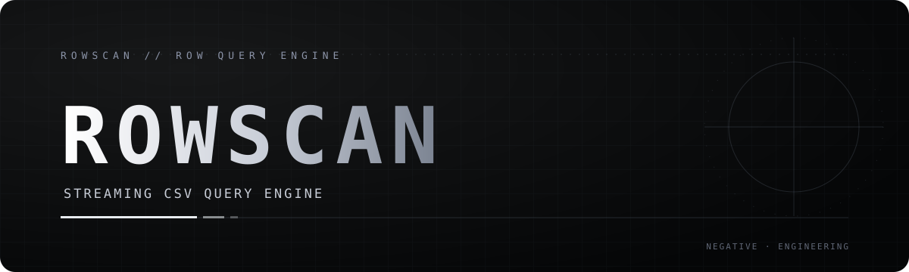

<div align="center">



# rowscan

**Zero-dependency streaming CSV query engine: filter, select, group-by and top-N.**

<p>
  
  
  
  
  
</p>

</div>

> rowscan (formerly `rowscan`) answers a question about a CSV file in one
> streaming pass, with no dataframe library and no type guessing.

## What it is

rowscan is a CSV query tool written against the Rust standard library. It reads a
file or stdin once, applies stages left to right — `filter`, `select`,
`group-by`, `top`, `count` — and writes CSV (or a Markdown table). Fields are
compared exactly; numeric operators only apply when both sides parse as finite
`f64`. There is no schema inference, no joins and no SQL parser, by design.

The crate and binary keep their original names, `sifr-query`; the product name
is rowscan and the repository is still `Sifr-Dev/rowscan`.

## Current capabilities

- **Filtering** with `=`, `!=`, `>`, `>=`, `<`, `<=`, `contains`; equality is
  numeric when both sides are finite numbers and exact string comparison
  otherwise (`Operation::Filter`, `src/query.rs`; `tests/query.rs`,
  `tests/parser.rs`).
- **Projection** with comma-separated `select` lists (`src/main.rs`,
  `tests/cli.rs`).
- **Group-by aggregates** — `count`, `sum`, `avg`, `min`, `max` over the
  group-by column's numeric values, groups sorted by exact key (`run_query`,
  `src/query.rs`; `tests/query.rs`).
- **Top-N** — descending numeric order, stable on ties, at most N rows retained
  (`Operation::Top`; `tests/cli.rs`).
- **Streaming memory** — one record at a time for non-buffering stages; memory
  grows with distinct groups or N, not with input rows (`CsvReader`,
  `src/csv.rs`; the benchmark below shows 2.2 MB RSS on 1 M rows).
- **Strict CSV** — quoted commas, quotes, CR/LF/CRLF preserved; malformed CSV,
  invalid UTF-8, ragged rows, empty input and bad arguments exit 2
  (`src/csv.rs`, `tests/parser.rs`, `tests/cli.rs`).
- **Explicit limits** — 1 MiB per field, 16 MiB per logical record, 16,384
  columns (`src/csv.rs`; `docs/contract.md`).
- **Markdown output** — `--markdown` renders a table (`src/main.rs`).
- **Broken-pipe safety** — a closed stdout is a normal exit, not a panic
  (`tests/cli.rs`).
- **24 Cargo tests** across unit, CLI, parser, query, differential and
  fuzz-regression targets.
- **Randomized oracle** — `tests/differential.py` checks 700 parser fixtures,
  100 filter/top/group fixtures and 150 Markdown fixtures against Python's `csv`
  module; `tests/fuzz_regression.rs` replays 5,000 arbitrary-byte inputs.
- **Nightly fuzz target** — `fuzz/fuzz_targets/csv_parser.rs` for coverage-guided
  ASan fuzzing (scheduled CI job, not a required per-push check).
- **Pinned toolchain** — `rust-toolchain.toml` pins 1.100.0 so CI is reproducible.

## Quick start

```sh
git clone https://github.com/Sifr-Dev/rowscan.git
cd rowscan
cargo build --release
./target/release/sifr-query data.csv filter country = ke
./target/release/sifr-query data.csv group-by plan count
./target/release/sifr-query data.csv top 10 age
cat data.csv | ./target/release/sifr-query count
```

Stages compose left to right; `count` is terminal:

```sh
./target/release/sifr-query data.csv filter plan = pro select country,age
./target/release/sifr-query data.csv filter country = ke group-by plan count --markdown
```

## Verification

```sh
cargo build --release --locked
cargo fmt --all -- --check
cargo clippy --locked --all-targets -- -D warnings
cargo test --locked --all-targets
cargo test --locked --release --all-targets
python3 tests/differential.py target/release/sifr-query
```

Observed on this machine (2026-11-28; Rust 1.100.0, Python 3.14.10, AMD Ryzen 7
7435HS, Linux 7.3.4):

```text
3 + 2 + 7 + 1 + 1 + 6 + 4 = 24 tests passed, 0 failed
Python csv differential: 700 parser fixtures, 100 filter/top/group fixtures,
and 150 markdown fixtures passed (seed 0x5f17c5)
```

CI (`.github/workflows/ci.yml`) runs formatting, clippy, debug and release
tests, and `cargo doc -D warnings`; the fuzz job runs only on schedule or
manual dispatch. The grammar, numeric rules, error contract and memory caveats
are in `docs/contract.md`; CI and release policy in `docs/development.md`.

## Architecture

| Path | Responsibility |
|---|---|
| `src/csv.rs` | Bounded CSV reader: quoting, CR/LF preservation, field and record limits |
| `src/query.rs` | Stage parsing/execution, numeric comparison, aggregation, top-N |
| `src/main.rs` | CLI: file/stdin selection, stage arguments, CSV/Markdown output |
| `src/lib.rs` | Library surface (`csv`, `query`) |
| `tests/` | CLI, parser, query, differential oracle, fuzz regression |
| `fuzz/` | Nightly `cargo-fuzz` target for the CSV parser |

## Benchmarks

1,000,000 rows × 4 columns (19 MiB CSV) on tmpfs, release build, warm cache.
Each figure is the best of three runs.

- **Hardware:** AMD Ryzen 7 7435HS (8C/16T), 15 GiB RAM, Linux 7.3.4-zen2 x86_64.
- **Workload:** `id,country,plan,age`; 4 plans, 5 countries, ages 18–80,
  generated with a fixed seed.
- **Methodology:** `/usr/bin/time -f "%e s %M KB"` around a single invocation,
  output to a file; CSV output includes the header row.

| Query | Time | Peak RSS | Rows/s |
|---|---|---|---|
| `group-by plan count` | 0.30 s | 2.2 MB | ≈ 3.3 M |
| `filter plan = pro select country,age` | 0.31 s | 2.2 MB | ≈ 3.2 M |
| `top 10 age` | 0.28 s | 2.3 MB | ≈ 3.6 M |

Reference: a Python `csv.DictReader` loop doing the same `group-by plan count`
takes 1.62 s and 12.2 MB on the same file — the output counts match exactly.
That is a standard-library comparison, not a dataframe benchmark; pandas was
not installed for this run.

## Limitations

- One input file or stdin; no joins, subqueries, sorting of full rows, or
  persistent storage.
- Numeric comparisons require finite `f64`; integers beyond 2^53 lose
  precision, and non-numeric ordered comparisons are errors rather than string
  ordering.
- Aggregates operate on the group-by column itself; `group-by country avg` is an
  error, not an average of some other column.
- Duplicate header names resolve to the first match.
- Memory grows with the number of distinct groups or with N in `top`; `top`
  on a very large N is bounded by N, not by input rows.
- No delimiter inference, no encoding conversion (invalid UTF-8 is rejected),
  no field normalization.
- 0.x: the CLI and output contract may change between minor versions
  (`Cargo.toml` `[package.metadata.release]`).

## Roadmap (NOT IMPLEMENTED)

- Multi-file input and joins.
- Additional aggregates (`median`, `stddev`) and `--where` expressions.
- Sorting full rows and streaming limit/offset stages.
- Delimiter and encoding options.
- A stable 1.0 CLI/output contract.
- Binary rename to `prism` while keeping `sifr-query` working.

## License

MIT. See [LICENSE](LICENSE).
